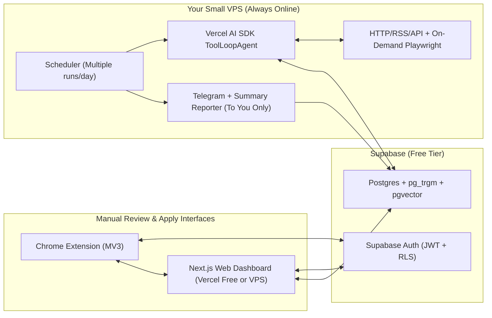

# Autonomous Job Search & Application System — Implementation Plan

> [!NOTE]
> Every component in this architecture runs at **$0/month** using free tiers and your existing small VPS, with zero required paid APIs or custom domains.

> [!IMPORTANT]
> **Manual-Only Apply & Outreach Policy**: The autonomous agent **never** auto-emails external recruiters/companies and **never** auto-applies to jobs. It discovers roles, checks duplicates, scores matches against your resume, and drafts human-like initial + follow-up emails (`draft_ready`). All job applications and email sends are executed **manually by you** from the dashboard or Chrome extension. Automated notifications (Telegram + Summary Email) are sent **only to you**.

## 1. $0/Month Tech Stack & Free-Tier Verification

| Layer | Choice | Free Tier / Cost | Why It Fits |
| :--- | :--- | :--- | :--- |
| **Web App & API** | **Next.js (App Router) + TypeScript** | **$0** (Vercel Hobby or self-hosted on VPS) | Unified full-stack app + API endpoints for the dashboard and Chrome extension. |
| **AI Agent Framework** | **Vercel AI SDK (`ai`)** (`ToolLoopAgent` + Zod `Output.object`) | **$0** (Open-source SDK) | Native multi-step tool loops, structured JSON extraction, and swappable LLM providers. |
| **LLM Providers (Free Chain)** | **Google AI Studio (Gemini Flash)** → **Groq** → **OpenRouter (`:free`)** | **$0** (No credit card required) | Primary + automatic fallback chain if one free provider hits rate limits (`429`). |
| **Database, Auth & Search** | **Supabase** (PostgreSQL + Auth + `pg_trgm` + `pgvector`) | **$0** (500 MB DB, 50k MAU) | Stores jobs, applications, emails, and embeddings. VPS cron keeps DB active so it never hits the 7-day inactivity pause. |
| **Autonomous Cron & Scraper** | **Node.js Worker on your VPS** (`node-cron` + `cheerio` + on-demand `playwright`) | **$0** (Uses your existing VPS) | Runs multiple times a day with no serverless timeout limits, even when your laptop is off. |
| **Manual Outreach & Summary Email** | **Brevo Free** (300/day, no domain needed) or **Gmail App Password SMTP** | **$0** | Sends manual human-like outreach when you click Send, plus daily/per-run summary digests to your own inbox. |
| **Instant Alerts** | **Telegram Bot API** (`@BotFather`) | **$0** (Unlimited messages) | Real-time run summaries, top matches, and metrics directly on your phone. |
| **Browser Helper** | **Chrome Extension (Manifest V3)** | **$0** (Load unpacked locally) | One-click "Already Applied?" fuzzy check, save job, mark applied, and AI email draft on any job site. |

---

## 2. System Architecture

### Why Hybrid (Vercel/VPS + Chrome Extension) Works Best
1. **Autonomous VPS Worker** handles public APIs, RSS feeds, Greenhouse/Lever/Ashby ATS boards, and non-gated career pages multiple times a day—even when you are offline—and queues drafted outreach for your review.
2. **Chrome Extension** handles login-walled or anti-bot sites (like LinkedIn, Indeed, Glassdoor) *while you browse*, safely using your own active tab without risking account bans or CAPTCHA blocks.
3. **RAM-Safe VPS Design**: Because small VPS instances have limited RAM, the scraper uses lightweight HTTP/JSON/RSS (`fetch` + `cheerio`) first and only launches headless Playwright Chromium on-demand (single-browser instance, 1 page at a time, closed immediately after scraping).

---

## 3. Core Features Breakdown

### A. Authentication & Authorization
- **Authentication**: Supabase Auth (Email/Password + Magic Link).
- **Private Mode Option**: Ability to disable public signups (`NEXT_PUBLIC_ALLOW_SIGNUP=false`) and restrict via `ALLOWED_USER_EMAILS`.
- **Authorization**:
  - **PostgreSQL Row Level Security (RLS)** on every table (`auth.uid() = user_id`).
  - **Role support** (`profiles.role`: `'owner' | 'user'`).
  - **Chrome Extension Auth**: Authenticated via Supabase JWT stored in `chrome.storage.local`.
  - **VPS Worker Auth**: Uses Supabase Service Role key server-side + shared `WORKER_SECRET`.

### B. Resume Parsing & Matching Pipeline
- Upload PDF/Markdown/text resume in the dashboard (parsed locally with `pdf-parse`).
- Vercel AI SDK extracts target roles, core skills, years of experience, preferred locations, and quantified achievements.
- Each newly discovered job is scored `0–100` against your resume with matched/missing skills and extracted recruiter/hiring email when listed.

### C. Multi-Source Job Discovery Agent (`ToolLoopAgent`)
1. `fetchJobFeeds`: RemoteOK, Remotive, Arbeitnow, The Muse, HN Who's Hiring, RSS feeds, and optional Adzuna API.
2. `fetchATSBoards`: Public Greenhouse, Lever, and Ashby job boards.
3. `inspectCareerPage`: Fetches public career pages (lightweight HTTP first, Playwright fallback only for JS-rendered public pages).
4. `recordDiscoveredJob`: Checks Supabase before saving so already-seen or already-applied jobs are skipped.

### D. Full Application Tracking System
- **Statuses**: `discovered` → `matched` → `draft_ready` → `applied` → `followed_up` → `replied` → `interviewing` → `offer` | `rejected` | `skipped` | `archived`
- **Manual Outreach Review**: Review, edit, copy, or click **Send Now** manually inside the tracker for initial and follow-up emails.

### E. Human-Like Apply & On-Demand Follow-up Email Drafting
- Drafts concise (110–165 word) personalized **initial application emails** referencing concrete achievements from your resume.
- **On-Demand Follow-ups Only**: Follow-ups are held and never pre-generated automatically. You trigger them on demand from the tracker—optionally pasting the recruiter's reply or notes so the draft responds directly to their message.
- **Strictly Manual Send**: No background job ever sends outreach emails to recruiters or submits job applications automatically.
- **Auto-Cancel Guard**: Pending follow-up drafts are cancelled automatically if status changes to `replied`, `interviewing`, `rejected`, or `archived`.

### F. "Somewhat Search" (Fuzzy + Semantic Already-Applied Checker)
1. **Canonical URL Match**: Strips `utm_*`, `ref`, and tracking params while preserving job IDs (`gh_jid`, `jk`, etc.).
2. **PostgreSQL `pg_trgm` Fuzzy Text Search**: Matches partial or slightly reworded company names and job titles.
3. **Semantic Vector Similarity (`pgvector`)**: Uses free Gemini embeddings (`gemini-embedding-001`, 768-dim) to catch cross-posted duplicates.

### G. Chrome Extension (Manifest V3)
- Auto-checks current tab against your applied history via "Somewhat Search".
- 1-click **Save Job**, **Mark Applied**, and **Draft Human Apply Email** (ready to review and copy).

### H. Telegram & Summary Email Reporting (Sent to You Only)
After scheduled runs, the VPS worker sends **you** a Telegram message and Summary Email containing:
- Found job count & Matched job count
- Emails drafted count
- Manual applications sent count, follow-ups sent count, and distinct employees/recruiters reached count
- Top newly matched job links

---

## 4. Database Schema & Monorepo Layout
- `supabase/migrations/001_initial_schema.sql`: Tables (`profiles`, `agent_settings`, `resumes`, `job_sources`, `jobs`, `applications`, `outreach_emails`, `agent_runs`), RLS policies, indexes, and `search_applied_jobs` RPC.
- `packages/shared`: Types, Zod schemas, URL normalization, AI SDK provider fallback chain, and outreach drafting helpers.
- `apps/web`: Next.js App Router dashboard, auth, and API endpoints.
- `apps/worker`: Scheduled VPS job discovery, matching, drafting, and Telegram/Summary Email reporter.
- `apps/extension`: Manifest V3 Chrome extension.
